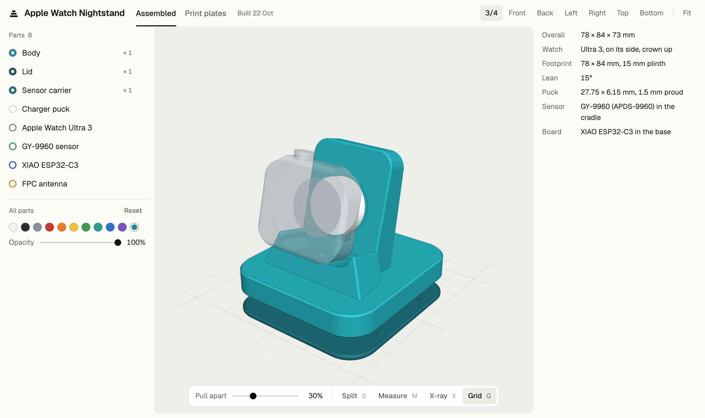

<picture>
  <source media="(prefers-color-scheme: dark)" srcset="brand/banner/banner-dark.svg">
  
</picture>

**Design real, printable parts with AI, for the printer on your desk.**

print-kit is a Claude Code plugin that teaches Claude how to design new parts and modify
existing ones the way an experienced maker would. It works whether this is your first print or
your thousandth.

I built it from my own tried-and-tested process, the one I've used to print hundreds, if not
thousands, of parts: stands, docks, enclosures, mounts and Gridfinity bins. Claude gets my design
rules, a profile of your printer and slicer, and the tools to check a part before you print it.
I hope it helps your workflow and your 3D printing journey.

## What you get

- **Setup for your printer.** One command asks about your printer, slicer and materials, then every part is sized for them.
- **Calibrated to your printer.** An optional small test print teaches it the gaps your own printer needs, so parts fit the first time.
- **Design rules.** Claude follows tested clearances, printable shapes and a self-check before handing a part over.
- **Fit tests.** Small, fast test prints for snaps, pockets and plugs, with the results remembered for next time.
- **Model checks.** Every part is checked for bed fit, a flat first layer, overhangs and collisions.
- **3D viewer.** Spin, explode and measure your model, see print plates on your bed, and open them in your slicer.
- **Gridfinity bins.** Trace a tool from a photo and get a bin with a pocket shaped to fit it.

## Made with print-kit


Stands, docks, enclosures, mounts, Gridfinity bins and keyboard parts, all designed with Claude and printed on a Bambu Lab P2S.

## Install

You need [Claude Code](https://claude.com/claude-code). On Windows, install
[Git for Windows](https://git-scm.com/downloads/win) first: Claude Code needs its Bash.

Open Claude Code in the folder you keep your prints in (any folder works) and paste this:

```
Install print-kit for me: read https://raw.githubusercontent.com/jasoncronje/print-kit/main/INSTALL.md and follow it.
```

Claude adds the plugin, installs Python and OpenSCAD if they're missing (no admin rights), asks
about your printer one question at a time, and offers a small calibration print.

<details>
<summary><b>Install by hand</b></summary>

The same steps on macOS, Windows and Linux.

1. Add the plugin. Type these two lines into Claude Code:

   ```
   /plugin marketplace add jasoncronje/print-kit
   /plugin install print-kit@print-kit
   ```

2. Restart Claude Code in the folder you keep your prints in, and run:

   ```
   /print-kit:setup
   ```

   Setup installs what's missing, with no admin rights:

   - **Python**: Homebrew or Apple's Command Line Tools on macOS, `winget` on Windows. Ubuntu
     already has it (`python3 --version`).
   - **OpenSCAD**: Homebrew on a Mac that has it, otherwise the official snapshot from
     openscad.org into your user folder. On Linux with a non-x86 CPU, install it with your
     package manager first.

   Then it finds your slicer, asks about your printer, and writes `print-kit.json` and a
   `data/` folder. A slicer is optional: without one, the viewer saves the plate's `.3mf`.

3. Start a new session (or `/clear`) and ask for a part.

Rather install OpenSCAD yourself? Do it before step 2 and setup will use it:

```bash
brew install --cask openscad@snapshot   # macOS: the stable cask is disabled
winget install OpenSCAD.OpenSCAD        # Windows
sudo apt install openscad               # Debian/Ubuntu: older 2021 release, slower
```

</details>

Every push is tested on fresh macOS, Windows and Ubuntu machines: OpenSCAD install, model checks,
viewer build, the calibration piece, the trace and layout editors, and the session hook.

---

## After install

<details>
<summary><b>Something isn't working</b></summary>

1. Ask Claude to "run the print-kit doctor". It lists what's installed and what's missing.
2. If OpenSCAD is missing, get it from https://openscad.org/downloads.html.
3. If OpenSCAD is installed but not found, set `"openscad": "/full/path/to/openscad"` in `print-kit.json`.
4. Still stuck? [Open an issue](https://github.com/jasoncronje/print-kit/issues/new/choose) with the doctor's output.

</details>

<details>
<summary><b>Change your printer, slicer or materials</b></summary>

Run `/print-kit:setup` again and say what changed. To tune fits to your printer, say
"calibrate my printer".

</details>

<details>
<summary><b>Update print-kit</b></summary>

In a terminal, then restart Claude Code:

```
claude plugin marketplace update print-kit
claude plugin update print-kit@print-kit
```

</details>

<details>
<summary><b>Remove print-kit</b></summary>

In a terminal:

```
claude plugin uninstall print-kit@print-kit
claude plugin marketplace remove print-kit
```

What print-kit puts on your computer, all of it yours to keep or delete:

- `print-kit.json` and a `data/` folder in your projects folder (or `~/.config/print-kit/` for a user-wide profile).
- One folder per project you design.
- OpenSCAD, only if you let setup install it and Homebrew didn't: `~/Library/Application Support/print-kit` on macOS, `%LOCALAPPDATA%\print-kit` on Windows, `~/.local/share/print-kit` on Linux.

</details>

<details>
<summary><b>Named viewer addresses (optional)</b></summary>

For `https://<name>.localhost` viewer addresses instead of a port number, setup explains
[Portless](https://github.com/vercel-labs/portless) and offers to install it. To add it later,
run `/print-kit:setup` again, or install it yourself with `npm install -g portless`.

</details>

<details>
<summary><b>What goes online</b></summary>

Your models, measurements and profile stay on your computer. The viewer runs there too and
can't be reached from outside it. Two things go online: the pages load their fonts from Google
Fonts, and setup downloads OpenSCAD if you ask it to.

</details>

---

## The 3D viewer

<picture>
  <source media="(prefers-color-scheme: dark)" srcset="brand/viewer-dark.jpg">
  
</picture>

Every design gets an interactive 3D page, built by Claude and opened inside Claude Code. Ask for it
in plain words:

```
Show me the phone stand in the 3D viewer.
```

- **In the Claude Code desktop app** it opens in the preview pane, beside the chat.
- **In the terminal** Claude gives you a link to open in your browser.

What you can do there:

- **Look at the assembled model.** Spin it, pull the parts apart, cut through it, X-ray it, and measure between two points.
- **Check the print plates.** Each plate is laid out on your printer's bed, with overhangs marked in red.
- **Send a plate to your slicer.** One button opens it there. Without a slicer, it saves the plate's `.3mf`.

The slicer button is tested with Bambu Studio on macOS. OrcaSlicer, PrusaSlicer and Cura, and every
slicer on Windows and Linux, are set up from their documented install paths and not yet tried. If
yours doesn't open, the page says so: use "Download all plates + STLs" and open the file yourself.

It works offline: nothing loads from the internet.

The viewer closes itself about 5 minutes after you close its tab. Ask again to bring it back.

## Your profile

`print-kit.json` sits at the root of your projects folder (or in `~/.config/print-kit/` for all
folders). Every tool reads it:

```json
{
  "printer": { "name": "Prusa MK4", "bed_mm": [250, 210, 220], "nozzle_mm": 0.4 },
  "slicer": { "name": "PrusaSlicer", "open_command": ["open", "-n", "-a", "PrusaSlicer", "--args", "{file}"] },
  "materials": { "default": "PLA", "owned": ["PLA", "PETG"] },
  "rules": { "ask_before_print": true, "gridfinity_outline_gate": true },
  "taste": ["Rounded corners everywhere, 3 mm minimum"]
}
```

Full template with every field: `plugins/print-kit/templates/print-kit.json`.

## Your data

`data/` holds what you learn from real prints: object sizes (`objects/`), fit results (`fits.csv`),
print outcomes (`prints.csv`) and the hardware you own (`hardware.json`). Claude reads it before
picking a number and adds to it after each print. The clearance starting values in the skills come
from the author's Bambu P2S with PLA on a 0.4 nozzle; your own rows replace them as you test.

## A project

```
my-prints/
  print-kit.json
  data/
  phone-stand/
    phone_stand.scad     part = "assembly" | "body" | "fit_test" | "clash_*"
    stl/                 ready to slice, in print orientation
    viewer/config.json   the 3D viewer's parts and plates
    README.md
    CHANGELOG.md
```

## Roadmap

Planned, roughly in this order. Nothing here has a date.

- **A Gridfinity command.** One guided flow from "I want a bin for this tool" to a printed bin:
  photo, outline, pocket, grid size.
- **More slicers proven.** The slicer button is tested with Bambu Studio on macOS. OrcaSlicer,
  PrusaSlicer and Cura, and Windows and Linux, are next.
- **Calibration per material and nozzle.** Today's calibration print covers one nozzle and one
  filament at a time. Keeping a set for PETG, TPU and a second nozzle side by side comes next.
- **Remixing downloaded models.** Better tools for changing an STL or STEP file you didn't
  design: resize a hole, add a mount, split it for your bed.
- **A home page for your projects.** One page listing every project with its picture and viewer.
- **A short demo video.**

Want something else? [Suggest it](https://github.com/jasoncronje/print-kit/issues/new/choose).

## Brand

Logo, palette and usage: [brand/](brand/README.md).

## Credits

Mesh checks in `check_scad.py` are ported from `verify-model.py` in Wilson Waters' 3d-printing repo
(MIT). Gridfinity base geometry matches kennetek/gridfinity-rebuilt-openscad. The viewer uses
three.js.

## License

MIT
