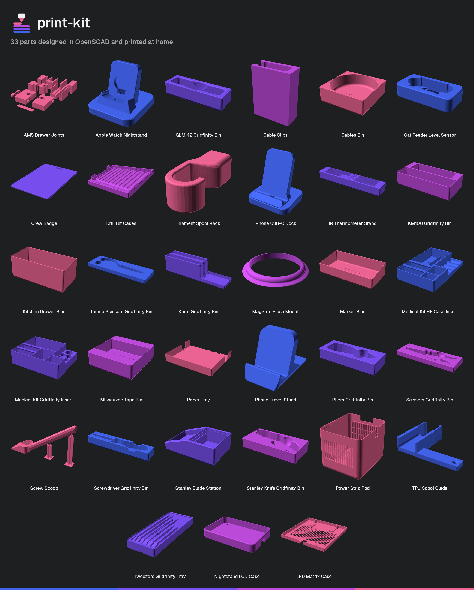

<picture>
  <source media="(prefers-color-scheme: dark)" srcset="brand/banner/banner-dark.svg">
  
</picture>

A Claude Code plugin for designing parametric OpenSCAD parts for your own 3D printer.

It gives Claude a set of house rules, a profile of your printer and slicer, and the workflow and tools
that came out of designing and printing dozens of real parts: stands, docks, enclosures, mounts and
Gridfinity bins.

## What you get

- **Setup for your printer.** One command asks about your printer, slicer and materials, then every part is sized for them.
- **Design rules.** Claude follows tested clearances, printable shapes and a self-check before handing a part over.
- **Fit tests.** Small, fast test prints for snaps, pockets and plugs, with the results remembered for next time.
- **Model checks.** Every part is checked for bed fit, a flat first layer, overhangs and collisions.
- **3D viewer.** Spin, explode and measure your model, see print plates on your bed, and open them in your slicer.
- **Gridfinity bins.** Trace a tool from a photo and get a bin with a pocket shaped to fit it.

## Made with print-kit



Stands, docks, enclosures, mounts, Gridfinity bins and keyboard parts, all designed with Claude and printed on a Bambu Lab P2S.

## Install

### 1. Claude Code

Skip this if you already have it.

```bash
curl -fsSL https://claude.ai/install.sh | bash
claude --version
```

### 2. OpenSCAD

```bash
# macOS (the stable cask is disabled in Homebrew; the snapshot is also much faster)
brew install --cask openscad@snapshot

# Linux (Debian/Ubuntu)
sudo apt install openscad

# Windows
winget install OpenSCAD.OpenSCAD
```

Check it's on your PATH:

```bash
openscad --version
```

On macOS, if `openscad` isn't found after installing the app:

```bash
ln -s /Applications/OpenSCAD.app/Contents/MacOS/OpenSCAD "$(brew --prefix)/bin/openscad"
```

### 3. Python

Python 3.9 or newer. Pillow is only needed for the photo-trace editor.

```bash
python3 --version
python3 -m pip install pillow
```

### 4. A slicer (optional)

Lets the viewer's "Open in slicer" button open a plate directly. Without one, the button saves the `.3mf`.

```bash
# macOS, pick yours
brew install --cask bambu-studio
brew install --cask orcaslicer
brew install --cask prusaslicer
brew install --cask ultimaker-cura
```

### 5. The plugin

Inside Claude Code:

```
/plugin marketplace add jasoncronje/print-kit
/plugin install print-kit@print-kit
```

Or from your terminal:

```bash
claude plugin marketplace add jasoncronje/print-kit
claude plugin install print-kit@print-kit --scope user
```

While the repo is private, you need read access and a GitHub login git can use (`gh auth login`).

### 6. Your projects folder

```bash
mkdir -p ~/prints && cd ~/prints
git init          # optional, but print-kit commits your changes when it's a repo
claude
```

Then, inside Claude Code:

```
/print-kit:setup
```

It checks for OpenSCAD and your slicer, asks a few questions, and writes `print-kit.json` and a `data/` folder.
Start a new session (or `/clear`) afterwards so the rules load.

### 7. Try it

```
Design a stand for my phone. Start with a fit test for the cradle.
```

### Updating

```bash
claude plugin marketplace update print-kit
claude plugin update print-kit@print-kit
```

Restart Claude Code to load the new version.

### Optional: Portless

For `https://<name>.localhost` viewer URLs instead of `http://127.0.0.1:<port>`:

```bash
npm install -g portless
```

Then answer yes when setup offers it, or set `"server": {"launcher": "portless"}` in `print-kit.json`.

macOS is the tested platform. Linux and Windows should work with the matching `open_command`
(setup fills it in).

## Your profile

`print-kit.json` sits at the root of your projects folder (or in `~/.config/print-kit/` for all
folders). Every tool reads it:

```json
{
  "printer": { "name": "Prusa MK4", "bed_mm": [250, 210, 220], "nozzle_mm": 0.4 },
  "slicer": { "name": "PrusaSlicer", "open_command": ["open", "-n", "-a", "PrusaSlicer", "--args", "{file}"] },
  "materials": { "default": "PLA", "owned": ["PLA", "PETG"] },
  "rules": { "ask_before_print": true, "gridfinity_outline_gate": true },
  "taste": ["Rounded corners everywhere, 3 mm minimum"]
}
```

Full template with every field: `plugins/print-kit/templates/print-kit.json`.

## Your data

`data/` holds what you learn from real prints: object sizes (`objects/`), fit results (`fits.csv`),
print outcomes (`prints.csv`) and the hardware you own (`hardware.json`). Claude reads it before
picking a number and adds to it after each print. The clearance starting values in the skills come
from the author's Bambu P2S with PLA on a 0.4 nozzle; your own rows replace them as you test.

## A project

```
my-prints/
  print-kit.json
  data/
  phone-stand/
    phone_stand.scad     part = "assembly" | "body" | "fit_test" | "clash_*"
    stl/                 ready to slice, in print orientation
    viewer/config.json   the 3D viewer's parts and plates
    README.md
    CHANGELOG.md
```

## Brand

Logo, palette and usage: [brand/](brand/README.md).

## Credits

Mesh checks in `check_scad.py` are ported from `verify-model.py` in Wilson Waters' 3d-printing repo
(MIT). Gridfinity base geometry matches kennetek/gridfinity-rebuilt-openscad. The viewer uses
three.js.

## License

MIT
