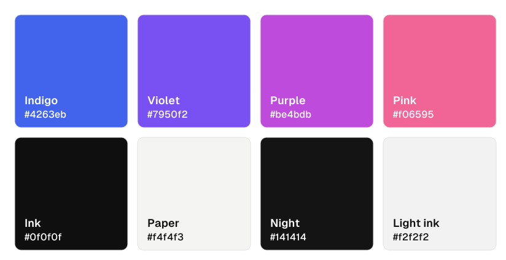

# print-kit brand

## The mark

A nozzle laying the top layer of a part. The layers step through **Colour shift**: indigo at the
bottom, then violet, purple, and pink for the hot nozzle and the fresh layer, like gradient filament
printed one layer at a time.

| File | Use |
|---|---|
| `logo/mark-colour.svg` / `-colour-dark.svg` | Default mark, on light / dark backgrounds |
| `logo/mark-black.svg` / `-white.svg` | One colour: stamps, engraving, single-colour prints |
| `logo/mark-small-*.svg` | 16–48 px: two layers, thicker beads |
| `logo/lockup-horizontal-*.svg` | Mark + wordmark side by side (headers, docs) |
| `logo/lockup-stacked-*.svg` | Mark over wordmark (square spaces, stickers) |
| `icon/icon.svg`, `icon/icon-512.png` | App/plugin icon; the 1024 px PNG is `plugins/print-kit/.claude-plugin/icon.png` |
| `banner/banner-light.svg` / `-dark.svg` | README header |
| `banner/social-preview.png` | GitHub social preview (Settings > Social preview) |

## Colour

| Name | HEX | Role |
|---|---|---|
| Indigo | `#4263eb` | Bottom layer |
| Violet | `#7950f2` | Layer 2 |
| Purple | `#be4bdb` | Layer 3 |
| Pink | `#f06595` | Hot nozzle and fresh layer |
| Ink | `#0f0f0f` | Heater block and text on light |
| Paper | `#f4f4f3` | Light background |
| Night | `#141414` | Dark background |
| Light ink | `#f2f2f2` | Heater block and text on dark |

Keep the order bottom to top. The shift colours are for the mark and accents, not body text.

## Type

Geist SemiBold for the wordmark (tracking −3%), Geist Medium for taglines. Geist is SIL OFL 1.1;
the logo files have the letters outlined, so no font is needed to use them.

## Use

- **Clear space:** one layer height plus one gap (about 12% of the mark's height) on every side.
- **Minimum size:** the full mark at 48 px and up; the small cut below that, down to 16 px.
  Lockups at 24 px mark height and up.
- **Backgrounds:** Paper, white, Night or black. On photos, use the one-colour white or black mark.
- **Don't:** recolour single layers, reorder the shift, add gradients, shadows or outlines, rotate
  the mark, stretch it, or set the wordmark in another font.

## Rebuild

`pip install fonttools cairosvg && python3 brand/src/build.py`
